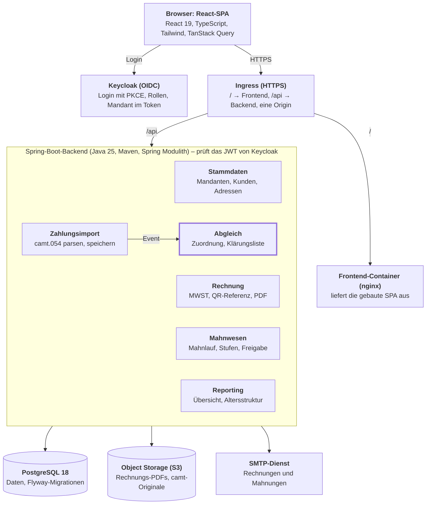
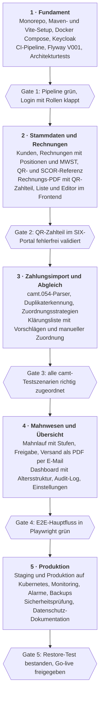

# Debitoren- und Zahlungsabgleich für Schweizer KMU – Projektplanung

Stand: 29.09.2026

## Ziel und Umfang

Die Anwendung erstellt QR-Rechnungen, ordnet Zahlungseingänge aus camt.054-Dateien automatisch den offenen Posten zu und führt ein mehrstufiges Mahnwesen. Sie ist von Beginn an mandantenfähig für Schweizer KMU.

**Funktionen der ersten Version**

- **Stammdaten:** Mandanten mit IBAN oder QR-IBAN, Kunden mit strukturierter Adresse und eigener Zahlungsfrist.
- **Rechnungen:** Positionen, MWST-Sätze als datierte Konfiguration, Rundung auf 5 Rappen (abschaltbar), QR- oder SCOR-Referenz, PDF mit QR-Zahlteil, Storno.
- **Zahlungsimport:** Upload von camt.054-Dateien mit Duplikaterkennung auf Datei- und Buchungsebene.
- **Abgleich:** automatische Zuordnung über die Referenz, Teil- und Überzahlungen, Klärungsliste für alles Unklare.
- **Mahnwesen:** täglicher Mahnlauf, konfigurierbare Stufen, Fristen und Gebühren, Freigabe vor dem Versand.
- **Übersicht:** offene und überfällige Posten, Altersstruktur, Zahlungseingänge.
- **Nachvollziehbarkeit:** Audit-Log für jede Änderung an Rechnungen, Zuordnungen und Mahnungen.

**Rollen**

| Rolle | Darf |
| --- | --- |
| Admin | Mandant, Benutzer, Mahnstufen und MWST-Sätze konfigurieren, zusätzlich alles der Buchhaltung |
| Buchhaltung | Kunden und Rechnungen pflegen, Dateien importieren, Zahlungen zuordnen, Mahnungen freigeben |
| Leser | alles ansehen, nichts ändern |

Nicht Teil der ersten Version: Finanzbuchhaltung, Kreditoren, MWST-Abrechnung und direkte Bankanbindung über EBICS; der Import läuft per Datei-Upload.

## Architektur und Techstack

Ein modularer Monolith: ein Spring-Boot-Deployable mit sechs fachlichen Modulen, davor eine React-SPA. Eine Zuordnung ändert Zahlung und Rechnung in derselben Transaktion; im Monolithen bleibt das atomar, ohne verteilte Transaktionen.



SPA und API teilen sich über den Ingress eine Origin. Die Module sprechen nur über ihre öffentlichen Schnittstellen oder über Events miteinander, etwa meldet der Zahlungsimport neue Zahlungen per Event an den Abgleich.

| Schicht | Wahl |
| --- | --- |
| Backend | Java 25 (LTS), Spring Boot 4.x, Spring Modulith, Maven Wrapper |
| Datenbank | PostgreSQL 18, Flyway, Hibernate/JPA |
| Frontend | React 19, TypeScript, Vite, Tailwind CSS v4 |
| Anmeldung | Keycloak (OpenID Connect) |
| Betrieb | Docker, Kubernetes mit Helm, GitHub Actions |

Genaue Versionen beim Projektstart auf start.spring.io und npm prüfen.

**Repository-Aufbau**

```
debitoren/
├── backend/            Maven-Projekt (pom.xml, mvnw)
├── frontend/           Vite-Projekt (package.json)
├── e2e/                Playwright-Tests
├── deploy/
│   ├── compose/        docker-compose.yml für lokal und E2E
│   └── helm/           Chart für Staging und Produktion
└── .github/workflows/
```

**Maven-Setup** mit `spring-boot-starter-parent` als Parent

| Plugin | Aufgabe |
| --- | --- |
| `spring-boot-maven-plugin` | ausführbares JAR und OCI-Image per `build-image` |
| `maven-surefire-plugin`, `maven-failsafe-plugin` | Unit- und Integrationstests getrennt |
| `jaxb-maven-plugin` | Java-Klassen für camt.054 aus dem XSD der Swiss Payment Standards |
| `jacoco-maven-plugin` | Abdeckung messen, Build unter der Grenze abbrechen |
| `spotless-maven-plugin` | einheitliche Formatierung, im CI nur geprüft |
| `springdoc-openapi-maven-plugin` | `openapi.json` für die Client-Generierung im Frontend |

**Wichtige Abhängigkeiten**

| Zweck | Bibliothek |
| --- | --- |
| Web, Validierung | Spring Web MVC, Bean Validation |
| Persistenz | Spring Data JPA, Flyway, PostgreSQL-Treiber |
| Security | Spring Security OAuth2 Resource Server |
| Module und Events | Spring Modulith |
| API-Beschreibung | springdoc-openapi |
| Mapping | MapStruct |
| QR-Rechnung | Swiss QR Bill von Codecrete |
| PDF | Thymeleaf-Vorlage, gerendert mit OpenHTMLtoPDF |
| camt.054 | Jakarta XML Binding (JAXB) |
| Audit | Hibernate Envers |
| Job-Sperre | ShedLock |
| Betrieb | Spring Boot Actuator, Micrometer Prometheus |
| Testdaten | Datafaker |

## SOLID

SOLID wird über Ports und Adapter in jedem Modul und über austauschbare Strategien für fachliche Regeln umgesetzt. ArchUnit und Spring Modulith prüfen die Abhängigkeitsrichtung bei jedem Build.

| Prinzip | Backend | Frontend |
| --- | --- | --- |
| **S** – Single Responsibility | `CamtParser` parst nur, `ZahlungsImportService` orchestriert, `QrRechnungRenderer` erzeugt nur das PDF. | Komponenten stellen dar, Hooks laden Daten (`useOffenePosten`), Formatierung liegt in `lib/format.ts`. |
| **O** – Open/Closed | Zuordnungsregeln implementieren `ZuordnungsStrategie`; eine neue Regel ist eine neue Klasse, der Abgleich-Service bleibt unverändert. Mahnstufen und MWST-Sätze kommen aus der Datenbank. | Tabellen wachsen über Spaltendefinitionen (TanStack Table), UI-Varianten über eine `variant`-Prop statt kopierter Komponenten. |
| **L** – Liskov | Jede Strategie liefert `Optional<ZuordnungsVorschlag>` und wirft bei „kein Treffer“ keine Exception. Ein späterer camt.053-Parser erfüllt denselben Vertrag `ZahlungsdateiParser`. | `Button`, `IconButton` und `LinkButton` teilen dieselben Basis-Props und sind gegeneinander austauschbar. |
| **I** – Interface Segregation | Kleine Ports wie `OffenePostenAbfrage` und `ZuordnungSpeichern` statt eines grossen Repositorys pro Modul. | Props enthalten nur, was die Komponente braucht, etwa `betrag` und `waehrung` statt der ganzen Rechnung. |
| **D** – Dependency Inversion | Use Cases hängen von Ports ab; Persistenz, PDF, Dateispeicher und Mail sind Adapter, eingebunden per Konstruktorinjektion. Der Dateispeicher schreibt lokal ins Dateisystem und produktiv in S3, ohne dass sich ein Use Case ändert. | Komponenten nutzen die generierten API-Hooks; in Tests ersetzt MSW das Backend. |

## Datenbank

PostgreSQL 18 mit Flyway-Migrationen. Jede fachliche Tabelle trägt `mandant_id`, Beträge sind `NUMERIC(12,2)`, und der offene Betrag wird nie gespeichert, sondern berechnet. So kann er nie vom tatsächlichen Zahlungsstand abweichen.

| Tabelle | Zweck | Wichtige Spalten und Regeln |
| --- | --- | --- |
| `mandant` | Firma, die Rechnungen stellt | `name`, `iban`, `qr_iban`, strukturierte Adresse |
| `kunde` | Debitor | `UNIQUE(mandant_id, kundennummer)`, `strasse`, `hausnummer`, `plz`, `ort`, `land` (ISO-Code), `email`, `zahlungsfrist_tage` |
| `rechnung` | Rechnungskopf | `UNIQUE(mandant_id, rechnungsnummer)`, `UNIQUE(mandant_id, referenz)`, `status`, `rechnungsdatum`, `faellig_am`, `waehrung CHECK IN ('CHF','EUR')`, `total`, `version` |
| `rechnungsposition` | Positionen | `menge`, `einzelpreis`, `mwst_satz_id`, `betrag CHECK >= 0` |
| `mwst_satz` | Datierte MWST-Sätze | `code`, `satz`, `gueltig_ab`, `gueltig_bis` |
| `zahlungsdatei` | Importierte camt-Datei | `UNIQUE(mandant_id, sha256)`, `dateiname`, `speicherort`, `importiert_am`, `anzahl_buchungen` |
| `zahlung` | Einzelne Gutschrift | `UNIQUE(mandant_id, bank_referenz)`, `valuta`, `betrag CHECK > 0`, `waehrung`, `referenz`, `auftraggeber`, `status` (OFFEN, ZUGEORDNET, KLAERUNG), `version` |
| `zuordnung` | Verbindet Zahlung und Rechnung, auch mehrfach | `betrag CHECK > 0`, `art` (AUTO, MANUELL), `regel`, `erstellt_von` |
| `mahnstufe` | Konfiguration je Mandant | `stufe`, `tage_nach_faelligkeit`, `mindestabstand_tage`, `gebuehr`, `textvorlage` |
| `mahnung` | Erzeugte Mahnung | `stufe`, `frist_bis`, `gebuehr`, `status` (VORSCHLAG, FREIGEGEBEN, VERSENDET) |
| `*_aud`, `revinfo` | Audit-Log (Hibernate Envers) | wer wann was geändert hat |
| `shedlock` | Sperre für geplante Jobs | verhindert einen doppelten Mahnlauf bei mehreren Instanzen |

**Berechnete Sicht:** `v_offene_posten` liefert je Rechnung Total plus Mahngebühren minus Zuordnungen sowie die Tage über Fälligkeit. Abgleich, Mahnlauf und Altersstruktur lesen alle daraus.

**Indizes:** `rechnung(mandant_id, status, faellig_am)`, `rechnung(mandant_id, referenz)`, `zahlung(mandant_id, status)`, `zuordnung(rechnung_id)`, `zuordnung(zahlung_id)`.

**Regeln für Migrationen**

- Dateien heissen `V001__stammdaten.sql`, `V002__rechnungen.sql` usw.; eine ausgeführte Migration wird nie mehr geändert.
- Schemaänderungen folgen dem Expand-Contract-Muster: erst hinzufügen, dann umstellen, zuletzt entfernen. So bleibt ein Rollback auf das vorherige Image ohne Datenbank-Rückbau möglich.
- Die Mandantentrennung läuft über Hibernate `@TenantId` auf allen fachlichen Entitäten; der Mandant stammt aus dem JWT.
- Testdaten kommen nicht aus Migrationen, sondern aus dem Seeder im Profil `dev` (siehe Mockup-Daten).

## Backend

Spring Boot 4 auf Java 25 als modularer Monolith: sechs Spring-Modulith-Module, jedes intern nach Ports und Adaptern geschnitten, dazu eine REST-API mit OpenAPI-Beschreibung.

**Paketstruktur**

```
ch.<firma>.debitoren
├── stammdaten/
├── rechnung/
├── zahlungsimport/
├── abgleich/
├── mahnwesen/
├── reporting/
└── shared/            Geld, Mandant, Fehlerformat, Security

je Modul:
├── api/               Controller, DTOs, MapStruct-Mapper
├── application/       Use Cases, Transaktionsgrenzen
├── domain/            Entitäten, Wertobjekte, Ports
└── infrastructure/    Repositories, PDF, Parser, Mail
```

Die Entitäten tragen JPA-Annotationen; ein zweites, reines Domänenmodell würde nur Mapping-Code erzeugen. Die Domäne darf aber weder `api` noch `infrastructure` noch Spring Web kennen.

**Wertobjekte**

- `Geld(BigDecimal betrag, Currency waehrung)` mit Skala 2 und `RoundingMode.HALF_UP`; `double` kommt für Beträge nie vor.
- `QrReferenz`: 27 Ziffern, die letzte ist die Prüfziffer nach Modulo 10 rekursiv; der Konstruktor validiert. Nur zusammen mit einer QR-IBAN.
- `ScorReferenz`: ISO 11649 (`RF…`), für Mandanten mit normaler IBAN.

**Kernabläufe**

1. **Rechnung freigeben:** Entwurf wird Offen, erhält Nummer und Referenz, das PDF wird gerendert und unveränderlich abgelegt, Event `RechnungFreigegeben`.
2. **camt.054 importieren:**
    1. SHA-256 der Datei prüfen; eine bekannte Datei wird mit 409 abgelehnt.
    2. XML mit deaktivierten externen Entitäten parsen (Schutz vor XXE) und gegen das XSD validieren.
    3. Jede Transaktion als Zahlung speichern, bekannte Bankreferenzen überspringen.
    4. Nach dem Commit das Event `ZahlungenImportiert` publizieren; der Abgleich reagiert per `@ApplicationModuleListener`.
3. **Abgleich:** Die Strategien laufen in fester Reihenfolge (`@Order`):
    1. `ReferenzExaktStrategie`: Die Referenz trifft genau eine offene Rechnung. Nur diese Strategie ordnet automatisch zu.
    2. `BetragUndKundeStrategie`: Offener Betrag und Auftraggeber passen; erzeugt nur einen Vorschlag.
    3. Ergebnis: gleicher Betrag → bezahlt; kleinerer Betrag → teilbezahlt; grösserer Betrag → bezahlt und Rest in die Klärung; kein Treffer → Klärungsliste.
4. **Mahnlauf:** täglich per `@Scheduled` mit ShedLock. Für jede überfällige Rechnung wird die nächste Stufe bestimmt (Tage nach Fälligkeit, Mindestabstand zur letzten Mahnung) und ein Vorschlag erzeugt. Nach der Freigabe folgt der Versand als PDF per E-Mail.

**Transaktionen und Konflikte:** `@Transactional` sitzt auf den Use Cases. `@Version` auf `rechnung` und `zahlung` verhindert, dass zwei Personen dieselbe Zahlung gleichzeitig zuordnen; der zweite Versuch erhält 409.

**Fehlerformat:** RFC 9457 `ProblemDetail` mit fachlichen Codes wie `ZAHLUNG_BEREITS_ZUGEORDNET` oder `DATEI_BEREITS_IMPORTIERT`.

**Security:** OAuth2 Resource Server mit JWT von Keycloak. Rollen werden aus dem Token gemappt und per `@PreAuthorize` auf den Use Cases geprüft; der Mandant stammt aus dem Claim `mandant_id`. Ohne Anmeldung erreichbar ist nur `/actuator/health`.

**REST-Endpunkte**

| Methode | Pfad | Zweck |
| --- | --- | --- |
| GET, POST | `/api/kunden` | Kunden suchen, anlegen |
| GET, PUT | `/api/kunden/{id}` | Kunde lesen, ändern |
| GET | `/api/rechnungen` | Liste mit Filtern (Status, Fälligkeit, Kunde), paginiert |
| POST | `/api/rechnungen` | Entwurf anlegen |
| PUT | `/api/rechnungen/{id}` | Entwurf bearbeiten |
| POST | `/api/rechnungen/{id}/freigabe` | Entwurf freigeben |
| POST | `/api/rechnungen/{id}/storno` | Rechnung stornieren |
| GET | `/api/rechnungen/{id}/pdf` | Rechnungs-PDF |
| GET | `/api/rechnungen/{id}/zahlteil.svg` | Vorschau des QR-Zahlteils |
| POST | `/api/zahlungsdateien` | camt.054 hochladen (multipart) |
| GET | `/api/zahlungsdateien` | Importprotokoll |
| GET | `/api/zahlungen?status=KLAERUNG` | Klärungsliste |
| GET | `/api/zahlungen/{id}/vorschlaege` | Zuordnungsvorschläge |
| POST | `/api/zahlungen/{id}/zuordnungen` | Manuell zuordnen |
| DELETE | `/api/zuordnungen/{id}` | Zuordnung aufheben |
| GET | `/api/mahnungen?status=VORSCHLAG` | Mahnvorschläge |
| POST | `/api/mahnungen/freigabe` | Mahnungen gesammelt freigeben |
| POST | `/api/mahnlaeufe` | Mahnlauf manuell auslösen (Admin) |
| GET | `/api/reporting/uebersicht` | Kennzahlen für das Dashboard |
| GET | `/api/reporting/altersstruktur` | Offene Posten nach 0–30, 31–60, 61–90, über 90 Tagen |

## Frontend

React 19 mit TypeScript im Strict-Modus auf Vite, gestylt mit Tailwind CSS v4. Der API-Client wird aus der OpenAPI-Beschreibung des Backends generiert, damit Frontend und Backend nie auseinanderlaufen.

| Zweck | Wahl |
| --- | --- |
| Build, Pakete | Vite, pnpm |
| Styling | Tailwind CSS v4 mit Tokens per `@theme` in CSS; `clsx` und `tailwind-merge` für Klassen |
| UI-Bausteine | eigene Komponenten nach dem shadcn/ui-Muster auf Radix-Primitives |
| Routing | React Router 7 |
| Serverdaten | TanStack Query mit Hooks, die Orval aus `openapi.json` erzeugt |
| Formulare | React Hook Form mit Zod-Schemas |
| Tabellen | TanStack Table |
| Diagramme | Recharts |
| Anmeldung | `react-oidc-context`, Authorization Code mit PKCE gegen Keycloak |
| Formate | `Intl.NumberFormat('de-CH')` für Beträge, Datum als `dd.MM.yyyy` |
| Qualität | ESLint, Prettier mit Tailwind-Plugin für die Klassenreihenfolge, `tsc --noEmit` |

**Ordnerstruktur**

```
frontend/src
├── app/              Router, Provider, Layout
├── features/
│   ├── dashboard/
│   ├── kunden/
│   ├── rechnungen/
│   ├── zahlungen/    Import und Klärungsliste
│   └── mahnwesen/
├── shared/
│   ├── api/          von Orval generiert, nie von Hand ändern
│   ├── ui/           Button, Table, Badge, Dialog, Drawer, Betrag
│   └── lib/          format.ts, auth.ts
└── index.css         Tailwind-Import und @theme-Tokens
```

**Seiten**

| Route | Inhalt |
| --- | --- |
| `/` | Dashboard: Kennzahlen, Altersstruktur, letzte Importe |
| `/rechnungen` | Liste mit Filtern und Sammelaktionen |
| `/rechnungen/neu`, `/rechnungen/:id` | Editor mit Positionen, Live-Vorschau des QR-Zahlteils, PDF-Download |
| `/kunden`, `/kunden/:id` | Kundenliste und Detail mit offenen Posten |
| `/zahlungen/import` | Upload per Drag and Drop, Importprotokoll |
| `/zahlungen/klaerung` | Klärungsliste: Zahlung links, Vorschläge rechts, Zuordnung per Klick |
| `/mahnwesen` | Mahnvorschläge mit Sammelfreigabe, Verlauf |
| `/einstellungen` | Mandant, Mahnstufen, MWST-Sätze (nur Admin) |

**Regeln**

- Serverzustand lebt nur in TanStack Query, UI-Zustand lokal in der Komponente.
- Geschäftslogik bleibt im Backend; das Frontend formatiert und validiert Formulare, rechnet aber keine offenen Beträge.
- Eine gemeinsame Komponente `Betrag` rendert jeden Betrag: rechtsbündig, `tabular-nums`, Währung und Schweizer Tausendertrennzeichen.

## Design und Mockups

Eine ruhige, dichte Arbeitsoberfläche: helle Flächen, ein einziger Akzentton, Statusfarben mit fester Bedeutung und Beträge, die sich spaltenweise vergleichen lassen.

| Element | Tailwind | Verwendung |
| --- | --- | --- |
| Akzent | `brand-600`, `brand-700` | Primärbuttons, Links, aktiver Menüpunkt |
| Flächen und Linien | `white`, `slate-50`, `slate-200` | Karten, Seitenhintergrund, Tabellenlinien |
| Text | `slate-900`, `slate-500` | Inhalt, Nebeninformation |
| Status Offen | `slate` | Badge |
| Status Teilbezahlt | `amber` | Badge, Balken in der Altersstruktur |
| Status Bezahlt | `emerald` | Badge |
| Status Überfällig | `red` | Badge, Kennzahl im Dashboard |
| Status Klärung | `violet` | Badge, Zähler im Menü |
| Schrift | Inter, `text-sm` in Tabellen | Beträge mit `tabular-nums` |
| Form | `rounded-lg`, kaum Schatten | Trennung über Linien statt Schatten |

**Tokens in `index.css`**

```css
@import "tailwindcss";

@theme {
  --font-sans: "Inter", ui-sans-serif, system-ui, sans-serif;
  --color-brand-600: oklch(0.55 0.15 250);
  --color-brand-700: oklch(0.48 0.15 250);
}

@theme inline {
  --color-status-offen: var(--color-slate-600);
  --color-status-teilbezahlt: var(--color-amber-600);
  --color-status-bezahlt: var(--color-emerald-600);
  --color-status-ueberfaellig: var(--color-red-600);
  --color-status-klaerung: var(--color-violet-600);
}
```

Daraus entstehen Klassen wie `bg-brand-600` oder `text-status-ueberfaellig`, die im ganzen Projekt einheitlich bleiben.

**Layout**

- Seitenleiste mit Dashboard, Rechnungen, Kunden, Zahlungen, Mahnwesen und Einstellungen; Kopfzeile mit Mandantenwahl und Benutzermenü.
- Listen als Tabellen mit Filterleiste darüber; Details öffnen sich in einem seitlichen Drawer, die Liste bleibt sichtbar.
- Die Klärungsliste ist der wichtigste Arbeitsbildschirm: links die ungeklärten Zahlungen, rechts die Vorschläge zur gewählten Zahlung.

**Wireframe Klärungsliste (Beispieldaten)**

```
+-----------------------------------------------------------------------------------+
| Debitoren       Zahlungen > Klärungsliste                               Mandant v |
+---------------+-------------------------------------------------------------------+
| Dashboard     | Klärungsliste                                                     |
| Rechnungen    | 4 ungeklärte Zahlungen · Beispieldaten                            |
| Kunden        |                                                                   |
| > Zahlungen   | +-------------------------------------+ +-----------------------+ |
| Mahnwesen     | | > Keller Haustechnik   CHF 1’840.00 | | Vorschläge            | |
| Einstellungen | |   12.09.2026 · ohne Referenz        | |-----------------------| |
|               | |-------------------------------------| | RE-2026-0412          | |
|               | |   M. Brunner             CHF 250.00 | | offen: CHF 1’840.00   | |
|               | |   11.09.2026 · Referenz unbekannt   | | Regel: Betrag + Kunde | |
|               | |-------------------------------------| | [ Zuordnen ]          | |
|               | |   Gasser Treuhand         CHF 95.50 | |                       | |
|               | |   10.09.2026 · Überzahlung          | |-----------------------| |
|               | |-------------------------------------| | Suche: Rechnung …     | |
|               | |   Lüthi Bau AG           EUR 420.00 | +-----------------------+ |
|               | |   09.09.2026 · EUR auf CHF-Rechnung |                           |
|               | +-------------------------------------+                           |
+---------------+-------------------------------------------------------------------+
```

Die gewählte Zahlung ohne Referenz ist markiert (`>`); rechts steht der Vorschlag der Strategie „Betrag und Kunde“, zugeordnet wird mit einem Klick.

**Barrierefreiheit (WCAG 2.2 AA)**

- Status nie nur über Farbe: Jede Badge trägt ihren Text.
- Kontrast mindestens 4,5:1 für Text, sichtbarer Fokus mit `focus-visible:ring-2`.
- Alles per Tastatur bedienbar, auch Zuordnen und Sammelfreigabe.

## Mockup-Daten

Ein deterministischer Seeder erzeugt im Profil `dev` realistische Schweizer Testdaten. Ein camt.054-Generator baut dazu passende Bankdateien, die jeden Sonderfall des Abgleichs abdecken.

**Seeder**

| Objekt | Menge | Details |
| --- | --- | --- |
| Mandanten | 2 | einer mit QR-IBAN (QR-Referenz), einer mit normaler IBAN (SCOR-Referenz) |
| Kunden | 200 je Mandant | Datafaker mit `Locale.of("de", "CH")`, strukturierte Adressen, Firmen und Privatpersonen gemischt |
| Rechnungen | 1'500 je Mandant über 18 Monate | 1 bis 8 Positionen, gemischte MWST-Sätze, rund 5 % in EUR |
| Zahlungsstand | – | etwa 60 % bezahlt, 10 % teilbezahlt, 20 % offen, 10 % überfällig mit Mahnungen verschiedener Stufen |
| Mahnstufen | 3 | Beispielwerte: Erinnerung nach 10 Tagen ohne Gebühr, 1. Mahnung nach 30 Tagen, 2. Mahnung nach 45 Tagen mit Gebühr |
| Benutzer | 3 | `admin`, `buchhaltung`, `leser` im Keycloak-Realm-Import |

Der Seeder nutzt einen festen Zufalls-Seed. Jede Instanz erhält so dieselben Daten, und Screenshots sowie E2E-Tests bleiben stabil.

**camt.054-Testszenarien**

| Szenario | Erwartetes Ergebnis |
| --- | --- |
| Exakte Zahlung mit Referenz | Rechnung automatisch bezahlt |
| Teilzahlung | Rechnung teilbezahlt, Rest offen |
| Überzahlung | Rechnung bezahlt, Überschuss in der Klärung |
| Zwei Zahlungen für eine Rechnung | beide zugeordnet, Rechnung bezahlt |
| Dieselbe Datei nochmals | Import mit 409 abgelehnt |
| Bekannte Buchung in neuer Datei | Buchung übersprungen |
| Unbekannte Referenz | Klärungsliste |
| Ohne Referenz, Betrag und Name passen | Vorschlag, keine automatische Zuordnung |
| Sammelbuchung mit mehreren Transaktionen | jede Transaktion einzeln verarbeitet |
| EUR-Zahlung auf CHF-Rechnung | Klärungsliste |
| Referenz einer stornierten Rechnung | Klärungsliste |

- Jedes Szenario liegt als Golden File unter `src/test/resources/camt/` mit einer JSON-Datei des erwarteten Ergebnisses daneben.
- Die Beispieldateien der Swiss Payment Standards dienen als Referenz für Aufbau und Version des Schemas.
- Im Profil `dev` erzeugt `POST /api/dev/camt-testdatei` eine Datei aus den aktuell offenen Rechnungen; ideal für Demos.
- Das Frontend läuft mit `pnpm dev:mock` ohne Backend: Orval generiert MSW-Handler mit Faker-Daten aus derselben OpenAPI-Beschreibung.

## Tests

Die meisten Tests sitzen in der Domäne und laufen ohne Spring in Millisekunden. Integrationstests laufen gegen echtes PostgreSQL in Testcontainers, und ein schmaler Playwright-Satz prüft die Hauptflüsse durch alle Schichten.

| Ebene | Werkzeug | Prüft |
| --- | --- | --- |
| Domäne | JUnit 5, AssertJ, jqwik | Prüfziffer der QR-Referenz, Rundung, MWST, jede Zuordnungsstrategie, Berechnung der Mahnstufe |
| Web-Slice | `@WebMvcTest`, Spring Security Test | Validierung, Fehlerformat, erlaubte Rollen je Endpunkt |
| Persistenz | `@DataJpaTest`, Testcontainers PostgreSQL | Migrationen, Constraints, `v_offene_posten`, Mandantentrennung |
| Integration | `@SpringBootTest`, Testcontainers | camt-Golden-Files gegen erwartete Zuordnungen, Mahnlauf, Events zwischen Modulen mit dem Spring-Modulith-`Scenario` |
| Architektur | Spring Modulith `verify()`, ArchUnit | Modulgrenzen, keine Zyklen, Domäne ohne Abhängigkeit zu `api`, `infrastructure` und Spring Web |
| QR-Zahlteil | Validierung der QR-Bibliothek, SIX-Validierungsportal manuell je Release | Zahlteil normkonform |
| API-Vertrag | openapi-diff in CI | keine unbeabsichtigten Breaking Changes |
| Frontend | Vitest, React Testing Library, MSW | Formulare, Tabellen, Formatierung, Lade- und Fehlerzustände |
| End-to-End | Playwright gegen den Compose-Stack, axe-core | Rechnung → camt-Import → bezahlt; Mahnvorschlag → Freigabe; Barrierefreiheit |
| Last (optional) | k6 | Import einer Datei mit 10'000 Buchungen |

- Testdaten entstehen über Builder wie `RechnungTestBuilder`, nie über geteilte Fixtures.
- Unit- und Integrationstests sind getrennt: Surefire führt `*Test` aus, Failsafe `*IT`.
- JaCoCo bricht den Build unter 80 % Zeilenabdeckung in `domain` und `application` ab.
- Optional läuft PIT-Mutationstesting wöchentlich auf der Domäne.

## CI/CD

GitHub Actions prüft jeden Pull Request vollständig, `main` landet automatisch auf Staging, und Produktion erhält nach manueller Freigabe exakt dasselbe Image.

| Auslöser | Job | Schritte |
| --- | --- | --- |
| Pull Request | `backend` | `./mvnw -B verify`: Spotless-Check, Kompilieren, Unit-, Slice-, Integrations- und Architekturtests, JaCoCo-Grenze |
| Pull Request | `frontend` | `pnpm install --frozen-lockfile`, `pnpm lint`, `pnpm typecheck`, `pnpm test`, `pnpm build` |
| Pull Request | `api-vertrag` | `openapi.json` aus dem Backend erzeugen, mit `main` vergleichen, Client neu generieren und auf Abweichungen prüfen |
| Pull Request | `sicherheit` | CodeQL für Java und TypeScript, gitleaks, Abhängigkeits-Scan |
| Pull Request | `e2e` | Images bauen, Compose-Stack starten, Playwright, Traces als Artefakt |
| Push auf `main` | `images` | Backend per `spring-boot:build-image`, Frontend als nginx-Image, Trivy-Scan, Push in die GitHub Container Registry mit Commit-SHA als Tag |
| Push auf `main` | `staging` | Flyway-Job, dann `helm upgrade`, Smoke-Test auf Health, Login und eine API-Abfrage |
| Tag `v*` | `produktion` | GitHub Environment mit Pflichtfreigabe, derselbe Ablauf wie Staging mit dem getaggten Image, bei Fehler `helm rollback` |

**Regeln**

- `main` ist geschützt: Änderungen nur per Pull Request mit grünen Checks.
- Flyway läuft als eigener Helm-Job vor dem Rollout, nicht beim Start der App. Eine fehlerhafte Migration stoppt so das Deployment, bevor neue Pods starten.
- Renovate schlägt wöchentlich Updates für Maven, npm, Docker-Images und Actions vor.
- Conventional Commits und release-please erzeugen Versionsnummern und Changelog.
- Maven- und pnpm-Caches beschleunigen die Pipeline (`actions/setup-java` mit `cache: maven`, pnpm-Store-Cache).

## Deployment und Produktion

Produktion läuft containerisiert in einem Schweizer Rechenzentrum mit verwalteter PostgreSQL-Datenbank. Die Daten bleiben in der Schweiz, und jede Freigabe ist ein unveränderliches, geprüftes Image.

| Umgebung | Zweck | Infrastruktur | Daten |
| --- | --- | --- | --- |
| Lokal | Entwicklung | Docker Compose: PostgreSQL, Keycloak, Mailpit; Backend und Frontend im Dev-Modus; Dateien im lokalen Dateisystem | Seeder |
| Staging | Abnahme, E2E, Demo | wie Produktion, eigener Namespace und eigene Datenbank | Seeder, nie echte Kundendaten |
| Produktion | Betrieb | Kubernetes, verwaltete PostgreSQL, S3-Object-Storage, SMTP-Dienst | echte Daten |

**Hosting:** Exoscale in der Zone Zürich mit verwaltetem Kubernetes (SKS), verwalteter PostgreSQL und S3-kompatiblem Speicher (SOS); als Alternative cloudscale.ch. Ausschlaggebend sind Datenstandort Schweiz, vom Anbieter verwaltete Backups und rollende Updates ohne Ausfall. Angebot, Backup-Optionen und Preise vor dem Entscheid prüfen.

**Kubernetes-Aufbau (Helm-Chart unter `deploy/helm`)**

- Backend mit 2 Replikas, Readiness und Liveness über `/actuator/health/readiness` und `/actuator/health/liveness`, Ressourcen-Limits, Rolling Update.
- Frontend als nginx-Container mit der gebauten SPA.
- Keycloak mit eigener Datenbank, Realm als Import-Datei versioniert.
- Eingang über die Gateway API (z. B. Traefik oder Envoy Gateway), TLS per cert-manager und Let's Encrypt; `/` geht ans Frontend, `/api` ans Backend.
- Secrets als Sealed Secrets, im Repository nur verschlüsselt.

**Konfiguration:** Profile `dev`, `test` und `prod`; alle umgebungsabhängigen Werte kommen über Umgebungsvariablen, nichts Geheimes liegt im Repository.

**Sicherheit**

- Nur HTTPS mit HSTS und strikter Content Security Policy; SPA und API teilen sich eine Origin, daher entfällt CORS.
- XML-Parser ohne externe Entitäten und ein Grössenlimit für Uploads.
- Rate-Limit auf Anmeldung und Upload; jede Rollenprüfung serverseitig.
- Container laufen ohne Root-Rechte mit schreibgeschütztem Dateisystem.

**Datenschutz und Aufbewahrung**

- revDSG: Auftragsbearbeitungsvertrag mit dem Hoster, Datenschutzerklärung, Datenstandort Schweiz.
- Rechnungen, Mahnungen und Zahlungsdateien werden 10 Jahre aufbewahrt (OR Art. 958f). PDFs und camt-Originale liegen unveränderlich im Object Storage mit aktivierter Versionierung.

**Betrieb**

- Monitoring: Actuator und Micrometer liefern an Prometheus, Dashboards in Grafana; strukturierte JSON-Logs von Spring Boot gehen an Loki.
- Alarme bei fehlgeschlagenem Import, ausgebliebenem Mahnlauf, erhöhter 5xx-Rate, erschöpften DB-Verbindungen und ablaufenden Zertifikaten.
- Fachliche Metriken: Anteil automatisch zugeordneter Zahlungen und Grösse der Klärungsliste.
- Backups: tägliche Sicherung durch den Anbieter plus wöchentlicher `pg_dump` in einen getrennten Speicher; Restore-Test monatlich auf Staging.
- Rollback: vorheriges Image per `helm rollback`; dank Expand-Contract-Migrationen ohne Rückbau der Datenbank.

## Roadmap

Fünf Phasen in fester Reihenfolge; eine Phase ist erst abgeschlossen, wenn ihr Gate erfüllt ist.



Die Pipeline aus Phase 1 prüft jede spätere Änderung. Lokal läuft der ganze Stack ab Phase 1 über Docker Compose; Staging und Produktion entstehen in Phase 5.
